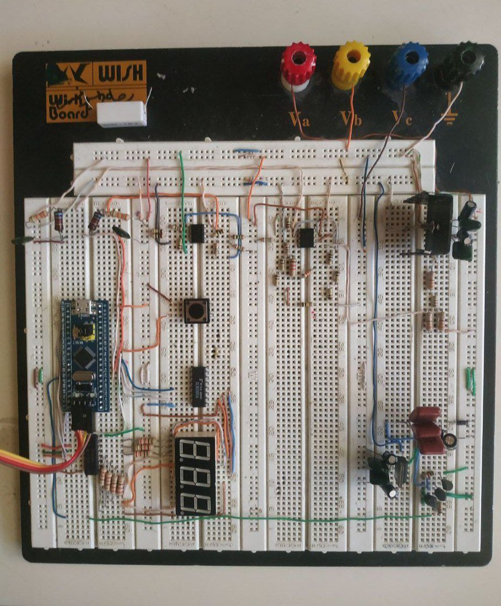
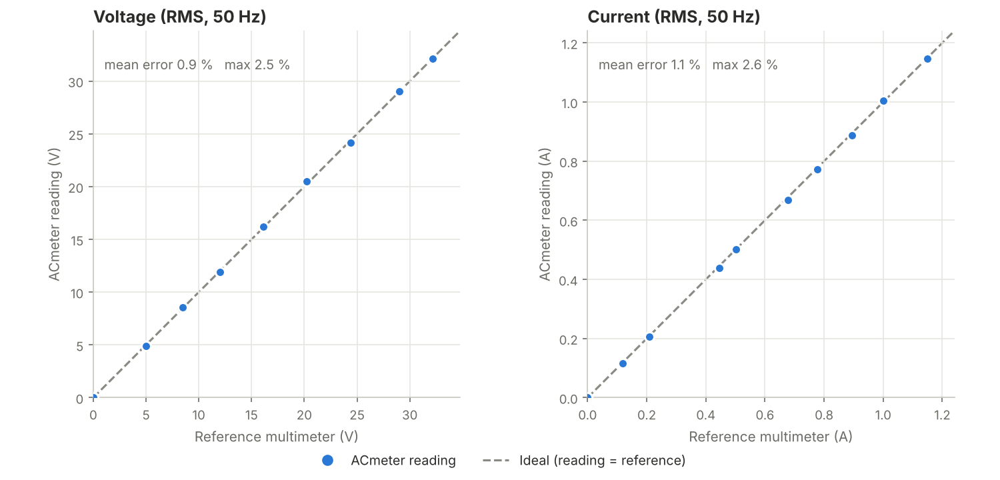
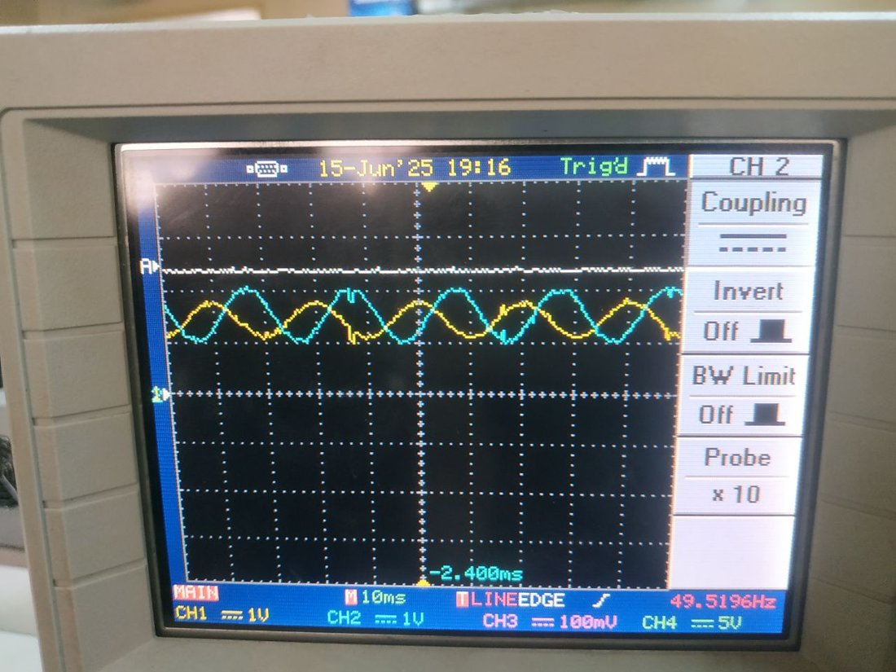
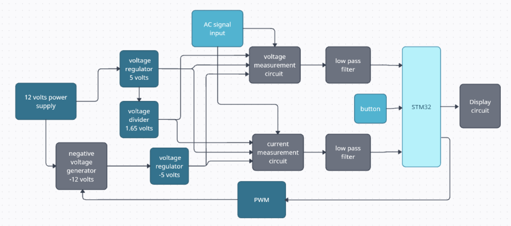

# STM32 AC Meter

**A bench AC power meter built from scratch on an STM32F103 "Blue Pill".** It measures a live sine wave and shows **RMS voltage, RMS current, frequency, power factor, and real, reactive and apparent power** on a 3-digit 7-segment display. One push button switches between the quantities.

<p align="center">
  
</p>

| Quantity | Range tested | Accuracy against a reference multimeter |
|---|---|---|
| RMS voltage | 0 – 32 V RMS (designed for up to 50 V peak) | **0.9 % mean error**, ≤ 1.2 % above 8 V |
| RMS current | 0 – 1.15 A RMS (designed for up to 1.6 A peak) | **1.1 % mean error** |
| Frequency | **25 – 999 Hz** (the spec only asked for 25 – 60 Hz) | **< 1 % error** |
| Power factor, P, Q, S | Resistive and R-L loads | Matched the phase shift seen on the oscilloscope |

---

## Highlights

- **True-RMS with O(1) work per sample.** A 1100-sample sliding window keeps running sums of *x* and *x²*. Each new ADC sample adds itself and subtracts the oldest one, so the RMS updates instantly without re-scanning the buffer. Subtracting the mean removes the 1.65 V bias that the analog front-end adds.
- **Noise-proof zero crossing that adapts to the signal.** Instead of a fixed midpoint, a crossing only counts when the signal swings from **below mean − 0.65·RMS** to **above mean + 0.65·RMS**. The threshold scales with the signal itself, so noise can never trigger twice in one period. This is what extended the frequency range from the required 60 Hz to **999 Hz**.
- **Phase and power factor from timing alone.** The meter counts how many samples the current crossing lags the voltage crossing, averages that over 70 periods, and converts it to an angle. P, Q and S follow from it.
- **Fully interrupt-driven firmware.** TIM3 triggers the ADC, TIM2 multiplexes the display and debounces the button, and TIM4 generates PWM. There is no `HAL_Delay()` and no busy waiting.
- **The MCU powers its own analog front end.** A push-pull charge pump driven by the MCU's 2 kHz PWM turns +12 V into about −12 V, which a 7905 regulates to −5 V for the op-amps. The analog side needs only a single 12 V supply.
- **Designed, simulated, then built.** Every analog stage was derived on paper, checked in PSpice, and then measured on the real board. Problems found along the way, such as divider loading, ADC channel cross-talk, PWM noise and floating inputs, were each traced to a cause and fixed.

---

## Results

### Accuracy against a reference multimeter (AVO), 50 Hz

<p align="center">
  
</p>

<table>
<tr>
<td valign="top">

**Voltage**

| Reference (V) | ACmeter (V) | Error |
|---:|---:|---:|
| 5.02 | 4.89 | −2.5 % |
| 8.50 | 8.56 | +0.7 % |
| 12.00 | 11.93 | −0.6 % |
| 16.10 | 16.21 | +0.7 % |
| 20.25 | 20.49 | +1.2 % |
| 24.37 | 24.16 | −0.9 % |
| 29.00 | 29.06 | +0.2 % |
| 32.19 | 32.11 | −0.2 % |

</td>
<td valign="top">

**Current** (30 Ω load, variac)

| Reference (A) | ACmeter (A) | Error |
|---:|---:|---:|
| 0.119 | 0.116 | −2.6 % |
| 0.210 | 0.206 | −1.9 % |
| 0.446 | 0.438 | −1.8 % |
| 0.502 | 0.502 | 0.0 % |
| 0.678 | 0.670 | −1.2 % |
| 0.778 | 0.773 | −0.7 % |
| 0.895 | 0.888 | −0.7 % |
| 1.000 | 1.004 | +0.4 % |
| 1.149 | 1.146 | −0.3 % |

</td>
</tr>
</table>

The raw data is in [`results/`](results/). Run [`tools/plot_results.py`](tools/plot_results.py) to rebuild the chart.

### Frequency

A function generator swept sine waves from **25 Hz to 999 Hz**, and the displayed frequency stayed within **1 %** across the range. The display shows at most three digits, so 999 Hz is the largest frequency it can show.

### Power factor

An inductor was placed in series with the load to create a phase shift. The oscilloscope shows the outputs of the voltage stage (blue) and the current stage (yellow), and the meter displayed **PF = 0.60** for this setup. Changing the load resistor moved the PF reading in step with the phase shift on the scope. Real, reactive and apparent power were checked with the same setup.

<p align="center">
  
</p>

---

## How it works

<p align="center">
  
</p>

1. **Power.** 12 V feeds an L7805 (+5 V). The MCU's PWM drives a push-pull charge pump that produces about −12 V, and an L7905 turns that into −5 V. A buffered divider makes the **1.65 V** mid-rail reference.
2. **Voltage stage.** A ≈1/31 resistive divider brings ±50 V down to ±1.6 V. A TL082 summing amplifier then adds 1.63 V, so the signal fits the ADC's 0 – 3.3 V window.
3. **Current stage.** A 0.15 Ω shunt feeds a difference amplifier (1.5 V/A), followed by a summing amplifier with the 1.65 V offset. At 1.6 A peak the output still fits 0 – 3.3 V.
4. **Filtering.** A first-order RC low-pass filter (6.8 kΩ, 10 nF, f<sub>c</sub> ≈ 2.3 kHz) on each ADC input removes the 2 kHz PWM ripple and any spikes.
5. **Sampling.** TIM3 triggers ADC1 at 3333 Hz. The ADC interrupt alternates between the voltage pin (PA1) and the current pin (PA2), one conversion at a time.
6. **Processing.** The sliding-window RMS, the adaptive crossing detector, and the frequency and phase averaging all run inside the ADC interrupt (see [`acmeter.c`](firmware/Core/Src/acmeter.c)).
7. **Display.** TIM2 at 180 Hz lights one digit per interrupt through an SN7448N BCD decoder and a ULN2003A digit driver. The button cycles through the seven quantities.

| Press | Shows | Display scale |
|:---:|---|---|
| 1 | RMS voltage | ×10 → `245` = 24.5 V |
| 2 | RMS current | ×100 → `115` = 1.15 A |
| 3 | Frequency | ×1 → `50` = 50 Hz |
| 4 | Power factor | ×100 → `60` = 0.60 |
| 5 | Real power P | ×100 |
| 6 | Reactive power Q | ×100 |
| 7 | Apparent power S | ×100 |

After each press, the mode number appears for about a second, and then the live value replaces it.

More detail:
- **[Hardware design](docs/hardware.md):** every analog stage with equations, schematics and PSpice results
- **[Firmware](firmware/README.md):** CubeMX setup, pin map, timers, and a walk through the algorithms

---

## Specification

| | Requirement | Achieved |
|---|---|---|
| Voltage | V<sub>peak</sub> < 50 V | ✔ |
| Current | I<sub>peak</sub> < 1.6 A | ✔ |
| Frequency | 25 – 60 Hz | ✔ **25 – 999 Hz** |
| Outputs | V<sub>rms</sub>, I<sub>rms</sub>, f, PF, P, Q, S | ✔ all seven |

## Main parts

| Part | Role |
|---|---|
| STM32F103C8T6 (Blue Pill) | 72 MHz Cortex-M3, 12-bit ADC, timers |
| TL082CP ×3 | Op-amps for the voltage, current and reference stages |
| L7805CV / L7905CV | +5 V / −5 V regulators |
| BC547 / BC557, 1N5818 | Push-pull negative voltage generator |
| SN7448N | BCD to 7-segment decoder |
| ULN2003A | Digit driver |
| 5361AS | 3-digit common-cathode 7-segment display |

Datasheet links are in [docs/hardware.md](docs/hardware.md#datasheets).

---

## Repository layout

```
.
├── firmware/
│   ├── README.md              CubeMX configuration, pin map, build notes
│   └── Core/
│       ├── Inc/               acmeter.h, display.h, app.h
│       └── Src/
│           ├── acmeter.c      RMS, frequency, phase, power (sliding windows)
│           ├── display.c      3-digit multiplexed 7-segment driver
│           └── app.c          startup, ISRs (ADC / TIM2 / button), main loop
├── docs/
│   ├── hardware.md            circuit design, equations, simulations
│   └── images/                schematics, simulations, CubeMX screenshots, photos
├── results/                   measured data (CSV)
└── tools/plot_results.py      regenerates the accuracy chart
```

## About

This was a mini-project in the Department of Electronic and Mechanical Systems at the Higher Institute for Applied Sciences and Technology (HIAST), completed in June 2025.
