# Hardware design

Each analog stage was designed on paper, simulated in PSpice, and then built and measured on the breadboard. This page follows that order for every block.

- [Power supply](#power-supply)
  - [Negative voltage generator (push-pull)](#negative-voltage-generator-push-pull)
  - [Voltage regulators](#voltage-regulators)
  - [1.65 V offset reference](#165-v-offset-reference)
- [Voltage measurement stage](#voltage-measurement-stage)
- [Current measurement stage](#current-measurement-stage)
- [Low-pass filters](#low-pass-filters)
- [Display](#display)
- [Button](#button)
- [Build notes](#build-notes)
- [Datasheets](#datasheets)

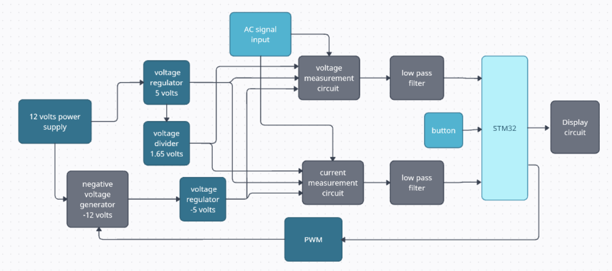

---

## Power supply

A single **12 V** supply feeds two branches:

- an **L7805CV** regulator for **+5 V** (op-amps, display, offset reference)
- a **push-pull negative voltage generator** driven by the MCU's PWM, which gives about **−12 V**. An **L7905CV** regulates that to **−5 V**.

The op-amps run from ±5 V. The ADC accepts only 0 – 3.3 V, so both measured signals are centered on a **1.65 V** offset.

### Negative voltage generator (push-pull)

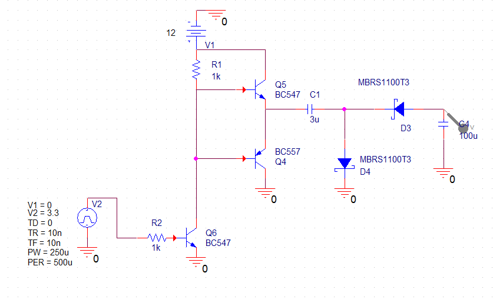

TIM4 drives this charge-pump inverter with a PWM signal. Tests showed that any frequency above about 700 Hz produces −9.34 V, and 720 Hz is enough for a stable output. The design uses **2 kHz**: higher frequencies hold up better under load, and the PWM ripple then sits far above the 25 – 60 Hz signals being measured, where the low-pass filters can remove it.

**How it works.** C1 is the flying capacitor that inverts the voltage, and C2 is the reservoir that supplies the negative rail. In steady state, ignoring diode and transistor drops, each PWM period has two phases:

| Phase 1: PWM = 0 V | Phase 2: PWM = 3.3 V |
|:---:|:---:|
| 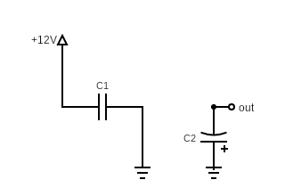 | 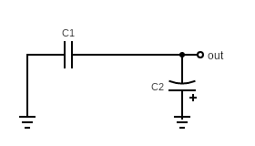 |
| Q3 is off, so Q1 saturates through R2 and its emitter sits at about 12 V. **C1 charges through D1.** D2 is reverse-biased, and C2 supplies the load. | Q3 turns on and pulls Q2's base down, so Q2's emitter drops to about 0 V and Q1 turns off. C1's voltage cannot change instantly, so its other plate falls to about −12 V. **D2 conducts and recharges C2.** |
| Q1, D1 on · Q2, Q3, D2 off | Q1, D1 off · Q2, Q3, D2 on |

PSpice shows the output settling at its negative value within about 100 ms:

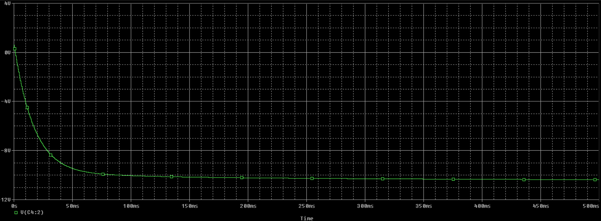

### Voltage regulators

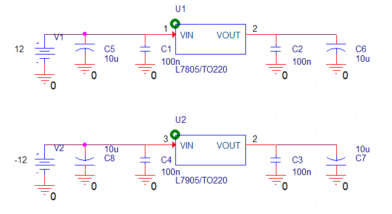

The L7805 accepts 7 – 35 V and the L7905 accepts −35 to −7 V. Both the 12 V input and the −9.34 V from the charge pump fall inside those ranges, and each regulator can supply up to 1.5 A.

The PWM inverter adds noticeable noise, so every regulator input and output has **a 10 µF electrolytic in parallel with a 100 nF ceramic** capacitor. The electrolytic absorbs slow, large swings, and the ceramic's low ESR and ESL handle fast, small ones. Together they act like one large, fast capacitor.

**Measured:** +5 V rail = **4.98 V**, −5 V rail = **−5.01 V**. A heatsink was added to the 7805.

### 1.65 V offset reference

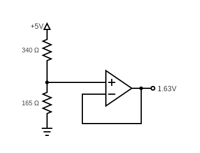

$$V_{ref} = \frac{165}{165 + 340} \times 5 = 1.63\ \text{V}$$

A TL082 voltage follower buffers the divider, so the stages that use the reference cannot load it.

---

## Voltage measurement stage

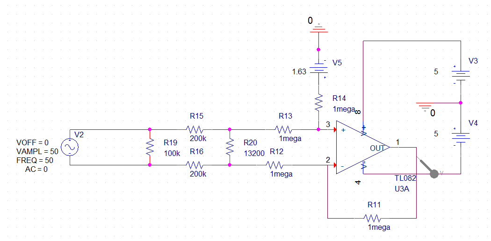

The AC input connects across **R19**. There are two stages.

**1. Divider**

$$V_{in1} = \frac{R_{20}}{R_{15} + R_{16} + R_{20}}\,V_{in} = 0.032\,V_{in}$$

At 50 V peak this gives ±1.597 V. In the build, R15 and R16 are each two 100 kΩ resistors in series instead of one 200 kΩ. This spreads the high voltage over more components and more board distance.

R19, in parallel with the input, does cost a little input impedance and adds some thermal noise. In return it gives leakage currents a path, keeps the input from floating, and lowers high-frequency noise.

**2. Summing amplifier (TL082, ±5 V supply)**

Solving by superposition:

- With only the offset connected: V+ = V− = 1.63/2, so Vout = 1.63 V
- With only the signal connected: V+ = V− = Vin1/2, so Vout = Vin1

$$V_{out} = V_{in1} + 1.63\ \text{V} \quad\Rightarrow\quad 0.037 \ldots 3.23\ \text{V}$$

That range almost exactly fills the ADC's 0 – 3.3 V window.

**Why 1 MΩ resistors in the summer?** Smaller values loaded the divider, because they appeared in parallel with R20 and lowered the ratio. Simulating a 50 V input shows the difference clearly:

| Summer resistors = 1 kΩ (loads the divider) | Summer resistors = 1 MΩ (isolated) |
|:---:|:---:|
| 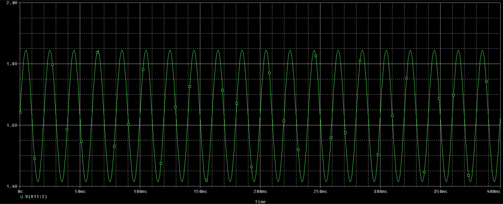 | 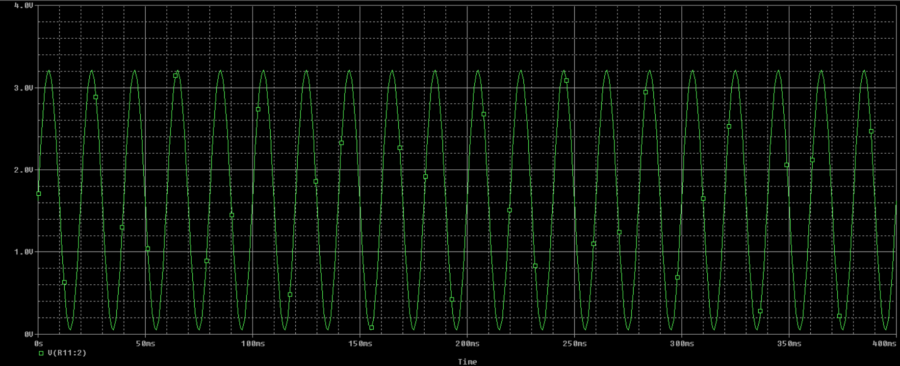 |
| Output swings only about 1.4 – 1.85 V | Output uses the full 0 – 3.3 V |

Input (red, ±50 V) against output (green):

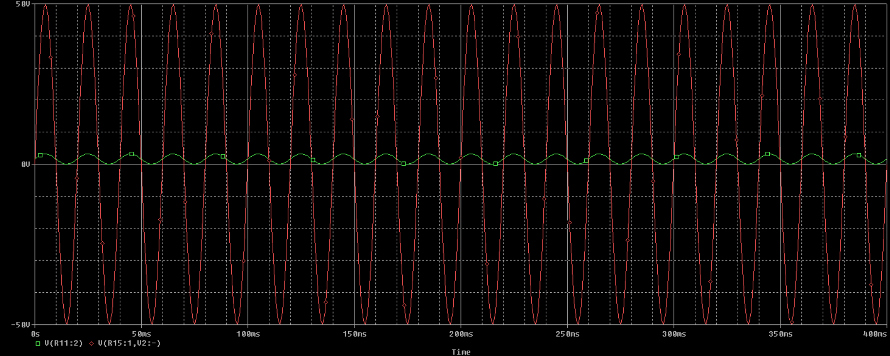

---

## Current measurement stage

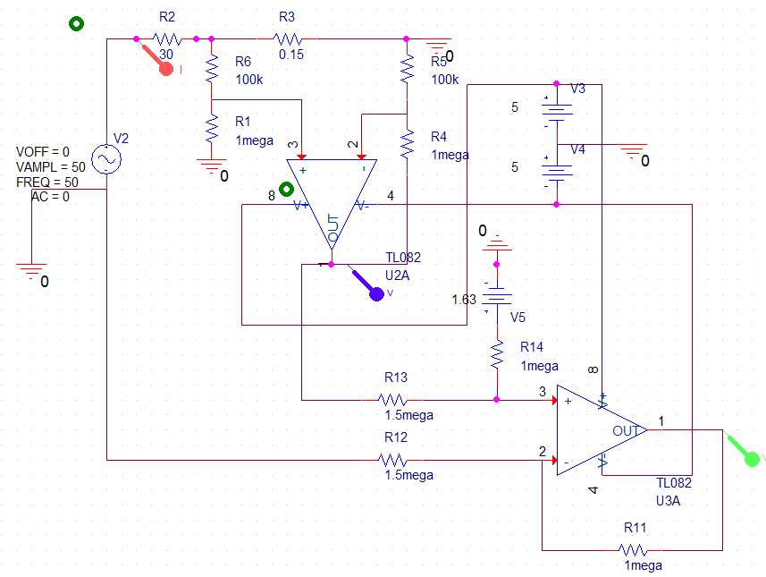

The current stage turns the current into a 0 – 3.3 V voltage centered on 1.65 V. It also has two stages, both built on a TL082.

**1. Difference amplifier across a 0.15 Ω shunt**

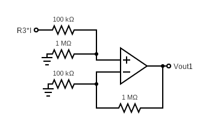

Every resistor except the shunt is large, so the meter barely loads the circuit it measures. The gain is high enough that even small currents give a signal well above the breadboard's noise.

$$V_{+} = 0.15\,I\,\frac{R_1}{R_1 + R_6}, \qquad V_{-} = V_{out1}\,\frac{R_5}{R_4 + R_5}$$

$$V_{out1} = \frac{0.15\,I\,R_1}{R_5} = 1.5\,I \quad (R_1 = 1\,\text{M}\Omega,\ R_5 = 100\,\text{k}\Omega)$$

| Low current | Maximum current (1.6 A) → ±2.48 V |
|:---:|:---:|
| 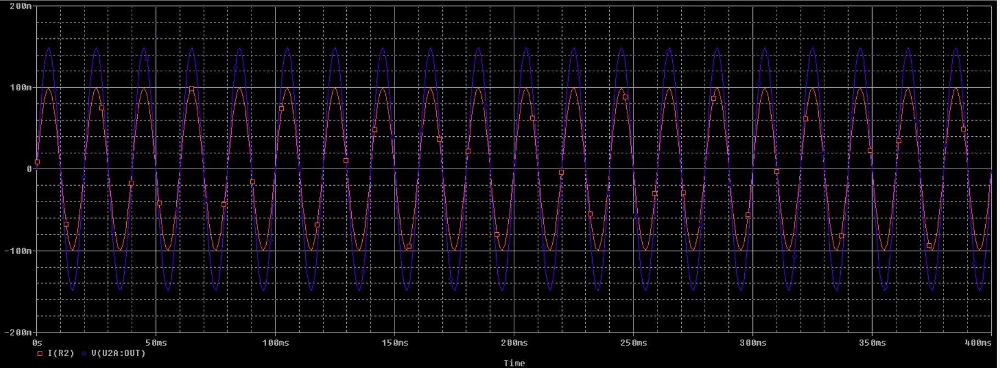 | 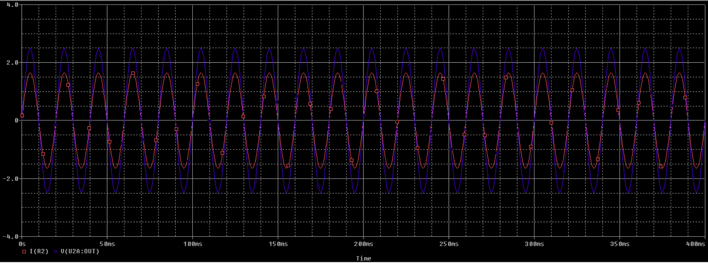 |

**2. Scaling and offset (summing amplifier)**

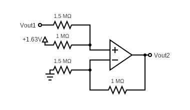

Stage 1 swings ±2.48 V, which is too wide for the ADC. Stage 2 scales the signal down and adds the offset. Its resistors (1 – 1.5 MΩ) are larger than stage 1's, so it does not load stage 1. By superposition:

$$V_{out2} = 1.63 + \frac{V_{out1}}{1.5} = 1.63 + I$$

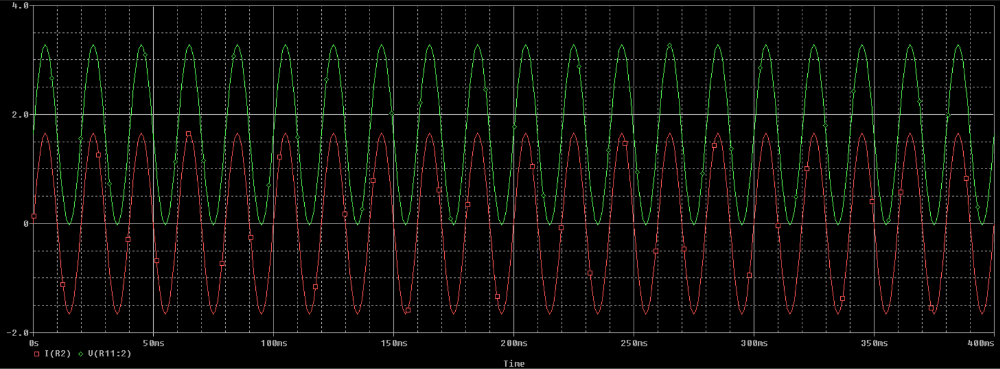

**Test setup:** a variac drove a high-power 30 Ω resistor, which gave 0 – 1.6 A. The 0.15 Ω shunt was wired **off the breadboard**, so the full test current never flowed through the board.

---

## Low-pass filters

The PWM inverter, the supply and the surroundings all inject noise. To clean the ADC inputs, and to protect them from spikes, each measurement output passes through a first-order RC filter:

$$R = 6.8\,\text{k}\Omega,\quad C = 10\,\text{nF},\quad f_c = \frac{1}{2\pi RC} \approx 2340\ \text{Hz}$$

The cutoff is deliberately high so that the filter barely affects the signal being measured.

Each ADC input also has a **22 kΩ resistor to ground**, so it never floats. A floating current input was found to shift the voltage-based frequency reading.

---

## Display

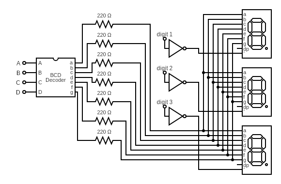

- **5361AS**: 3-digit, common-cathode 7-segment display
- **SN7448N** BCD decoder: four MCU pins (A – D) select the digit value, and it drives the seven segments through **220 Ω** resistors. Each segment draws 5 V / 220 Ω ≈ **23 mA**, which is bright and stays under the 30 mA limit. The MCU could not drive this directly, because it allows only 20 mA per pin and about 100 – 125 mA in total.
- **ULN2003A**: inputs 5 – 7 select which digit's common cathode is pulled to ground

| SN7448N | ULN2003A | 5361AS |
|:---:|:---:|:---:|
| 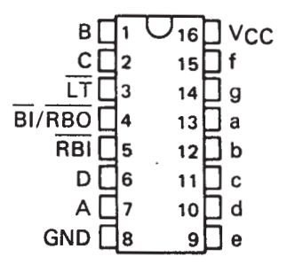 | 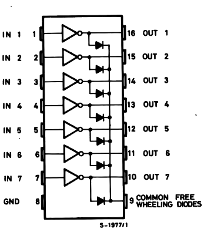 | 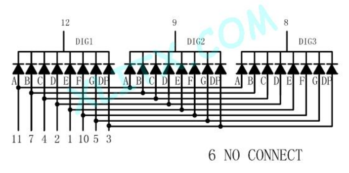 |

SN7448N wiring: LT, BI/RBO and RBI are tied to 5 V, A – D go to the MCU, and DP is unused. ULN2003A wiring: COM goes to 5 V, and outputs 5, 6 and 7 go to display pins 12, 9 and 8 (the three digits).

## Button

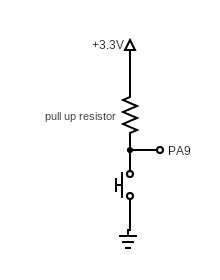

The push button connects the MCU pin to ground, and the internal pull-up is enabled. A falling-edge external interrupt registers the press, and a timer handles the debounce (see [firmware](../firmware/README.md#button-and-debouncing)).

---

## Build notes

- Everything is on one large breadboard. The 0.15 Ω current shunt is wired externally.
- The MCU ground is tied to the analog ground.
- The real measurements matched the PSpice simulations closely for the regulators, the voltage stage and the current stage.

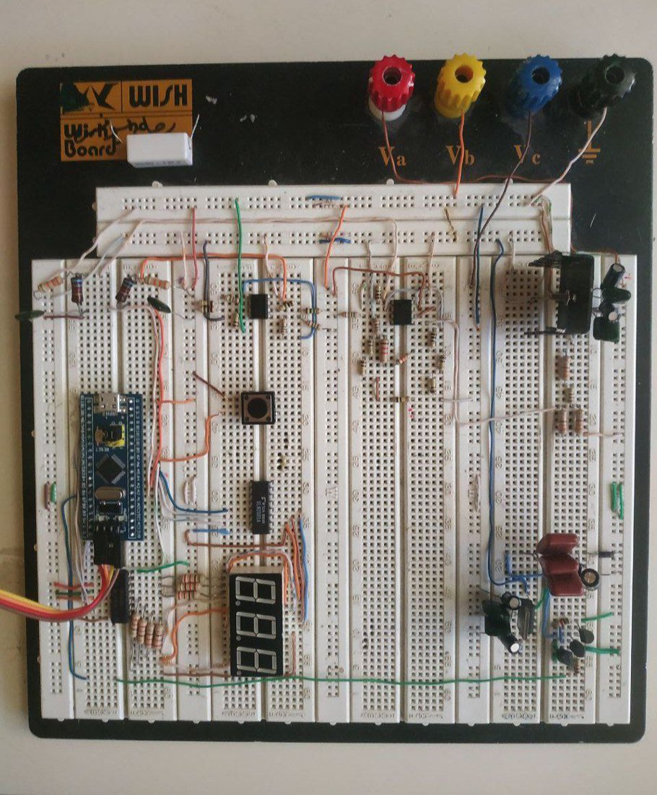

## Datasheets

| Part | Datasheet |
|---|---|
| TL082 | https://www.ti.com/lit/ds/symlink/tl082-n.pdf |
| ULN2003 | https://www.st.com/resource/en/datasheet/uln2001.pdf |
| 5361AS | https://www.xlitx.com/datasheet/5361AS.pdf |
| SN7448N | https://www.ti.com/lit/gpn/SN54LS47 |
| L7805CV | https://www.st.com/resource/en/datasheet/l78.pdf |
| L7905CV | https://www.st.com/resource/en/datasheet/l79.pdf |
| 1N5818 | https://www.vishay.com/docs/88525/1n5817.pdf |
| BC547 | https://cdn.sparkfun.com/assets/d/5/e/5/d/BC547.pdf |
| BC557 | https://www.onsemi.com/download/data-sheet/pdf/bc556b-d.pdf |
| STM32F103C8T6 | https://www.st.com/resource/en/datasheet/stm32f103c8.pdf |

**References:** A. S. Sedra and K. C. Smith, *Microelectronic Circuits*, 5th ed. (Oxford University Press, 2004) and 6th ed. (2011).
