# Firmware

The firmware targets the **STM32F103C8T6** ("Blue Pill") and uses the ST HAL. The project was generated with **STM32CubeMX**, built in **IAR Embedded Workbench**, and flashed and debugged over **ST-Link**.

The work splits into three parts:

| Part | Peripheral | What it does |
|---|---|---|
| **Input** | TIM3 → ADC1, EXTI | Samples voltage and current, and reads the button |
| **Processing** | (ADC interrupt) | Sliding-window RMS, frequency, phase and power |
| **Output** | TIM2, TIM4 | Multiplexes the 7-segment display and generates the 2 kHz PWM for the −12 V supply |

## Source files

| File | Contents |
|---|---|
| [`Core/Src/acmeter.c`](Core/Src/acmeter.c) | All measurement math: `update_rms_buffer`, `update_rms_buffer2`, `update_freq_buffer`, `update_phase_buffer`, `S`, `power`, `Q`, and the per-sample crossing detector |
| [`Core/Src/display.c`](Core/Src/display.c) | `DisplayNumber`, `SetBCD`, and the per-digit refresh |
| [`Core/Src/app.c`](Core/Src/app.c) | Peripheral start-up, the main loop (button and display selection), and the HAL callbacks for ADC, TIM2 and EXTI |

These files contain only the project's own code. The CubeMX-generated files (`main.c`, `stm32f1xx_hal_msp.c`, `stm32f1xx_it.c`, HAL drivers) are not stored here. Regenerate them from the settings below, then hook in the application:

```c
/* main.c */
#include "app.h"
...
  /* USER CODE BEGIN 2 */
  App_Start();
  /* USER CODE END 2 */

  while (1)
  {
    App_Loop();
  }
```

Copy `Core/Inc/*.h` and `Core/Src/*.c` into the generated project. CubeMX must use the pin labels below so that `main.h` defines `BCD_A_Pin`, `DIGIT1_Pin`, `button_Pin` and the rest.

---

## CubeMX configuration

### Pin map

<p align="center">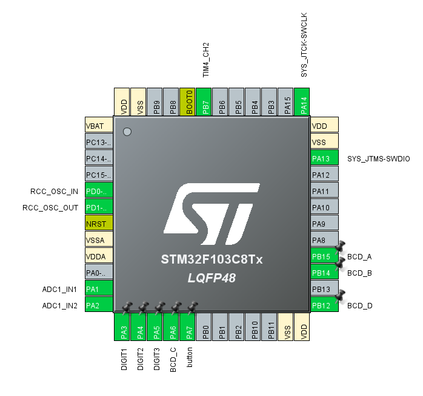</p>

| Pin | Label | Mode | Connected to |
|---|---|---|---|
| PA1 | ADC1_IN1 | Analog | Voltage stage output (through the low-pass filter) |
| PA2 | ADC1_IN2 | Analog | Current stage output (through the low-pass filter) |
| PA3 | `DIGIT1` | GPIO output, push-pull | ULN2003A IN5 → digit 1 |
| PA4 | `DIGIT2` | GPIO output, push-pull | ULN2003A IN6 → digit 2 |
| PA5 | `DIGIT3` | GPIO output, push-pull | ULN2003A IN7 → digit 3 |
| PB15 | `BCD_A` | GPIO output, push-pull | SN7448N A |
| PB14 | `BCD_B` | GPIO output, push-pull | SN7448N B |
| PA6 | `BCD_C` | GPIO output, push-pull | SN7448N C |
| PB12 | `BCD_D` | GPIO output, push-pull | SN7448N D |
| PA7 | `button` | GPIO EXTI, falling edge, pull-up | Push button to GND |
| PB7 | TIM4_CH2 | PWM | Push-pull negative voltage generator |
| PD0 / PD1 | RCC_OSC | HSE crystal | 8 MHz crystal |
| PA13 / PA14 | SWDIO / SWCLK | Serial Wire debug | ST-Link |

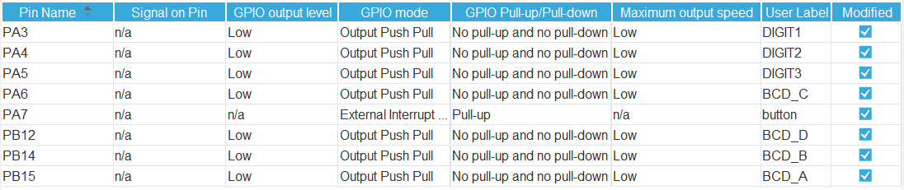

PA0 was avoided because CubeMX reported a conflict with another function on that pin:

 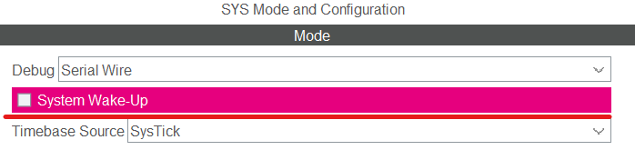

### Clock: 72 MHz from the 8 MHz HSE crystal

HSE 8 MHz → PLL ×9 → SYSCLK 72 MHz. AHB /1, APB1 /2 (36 MHz, timers at 72 MHz), APB2 /1, ADC prescaler /6 (12 MHz).

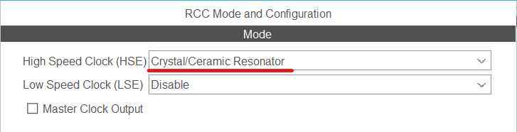<br>
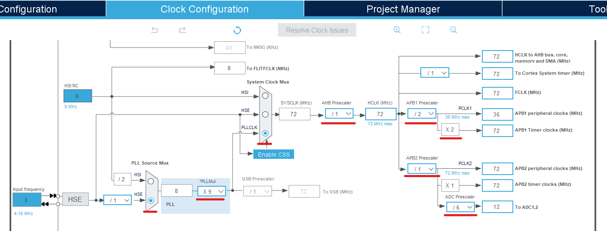

Debug is set to **Serial Wire**:

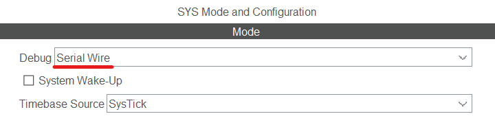

### Timers

| Timer | Prescaler | Period (ARR) | Rate | Used for |
|---|---:|---:|---:|---|
| **TIM3** | 7199 | 2 | 72 MHz / 7200 / 3 = **3333.33 Hz** | TRGO (update event) triggers ADC1 |
| **TIM2** | 999 | 399 | 72 MHz / 1000 / 400 = **180 Hz** | Display multiplexing, button debounce, display timing (interrupt) |
| **TIM4** | 35 | 999 | 72 MHz / 36 / 1000 = **2 kHz** | CH2 PWM mode 1 for the negative voltage generator |

At 50 Hz, TIM3 gives about **66.7 conversions per period**, shared between the two channels. The rate was chosen so it is **not** an exact multiple of 50 Hz, which means successive periods are sampled at slightly different points. That spreads the samples across the waveform and reduces bias.

| TIM3 | TIM2 | TIM4 |
|:---:|:---:|:---:|
| 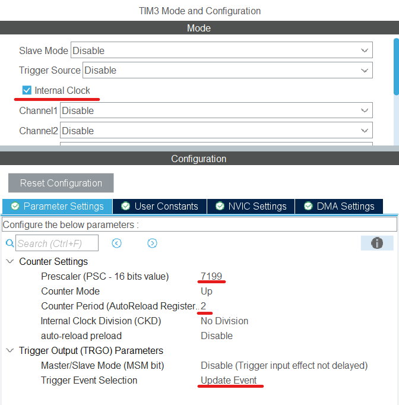 | 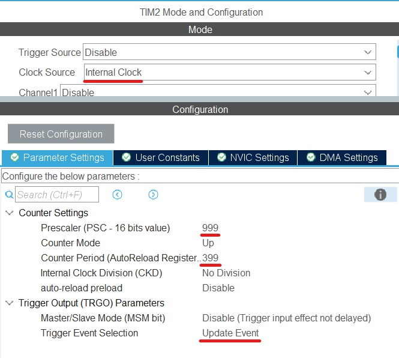 | 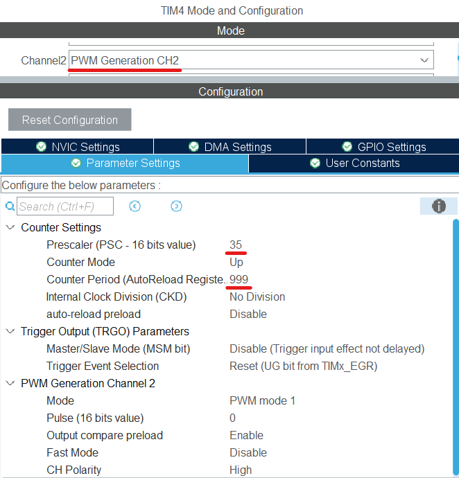 |

Global interrupts enabled for TIM3 and TIM2:

<br>


### ADC1

Channels IN1 and IN2 are enabled. The external trigger is **Timer 3 Trigger Out event**, the sampling time is **55.5 cycles**, and the ADC1/ADC2 global interrupt is enabled.

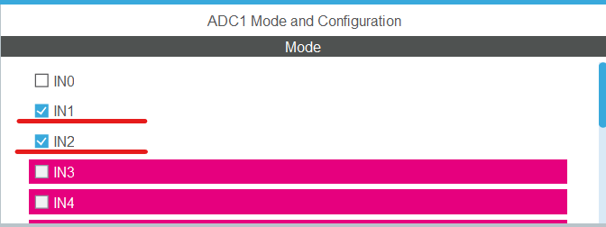<br>
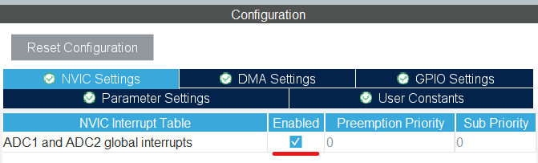

**Scan mode versus channel switching.** The first version used scan mode with two ranks, so both channels were converted together. This caused **cross-talk**: the voltage reading changed depending on whether the current input was floating or grounded. The fix was to use **a single rank** and have the ADC interrupt switch the channel after each conversion. With that change, only one input is active at a time and the cross-talk disappeared.

| Before: scan mode, 2 ranks | After: 1 rank, switched in software |
|:---:|:---:|
| 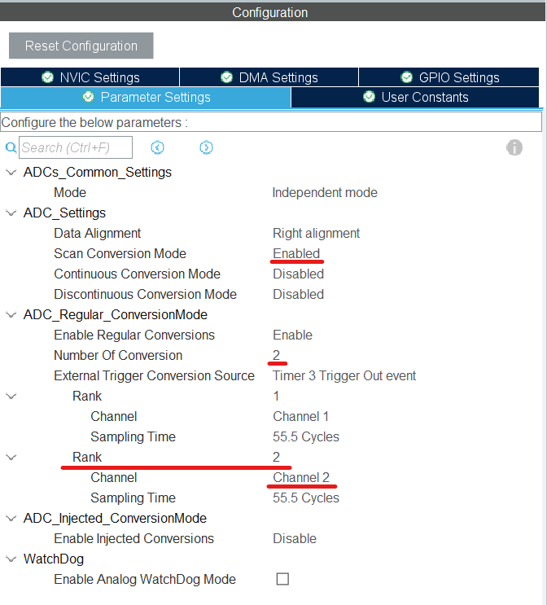 | 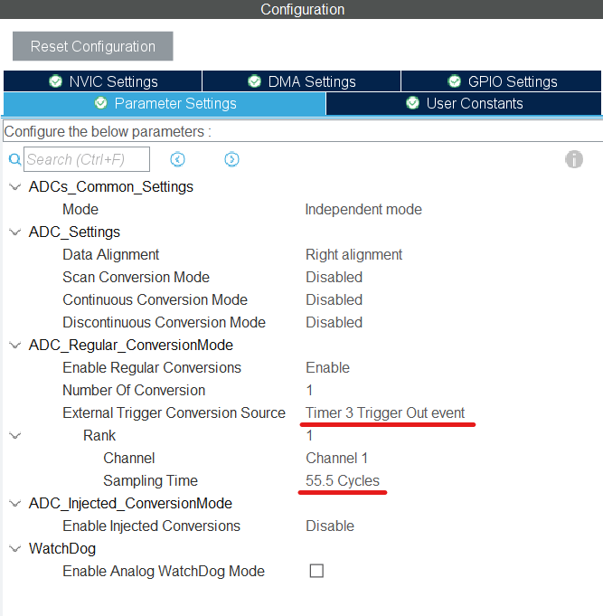 |

### Button (PA7)

GPIO mode is **External Interrupt, falling edge**, with the internal **pull-up** enabled. The EXTI line[9:5] interrupt is enabled.

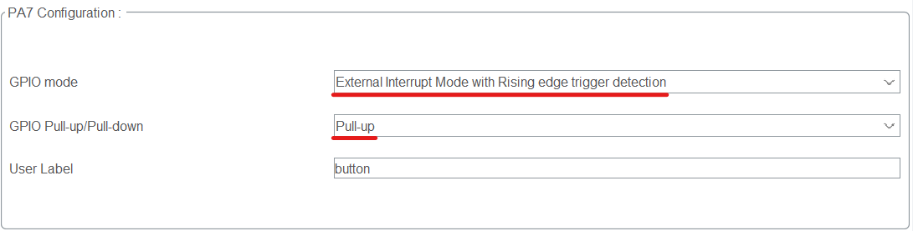<br>
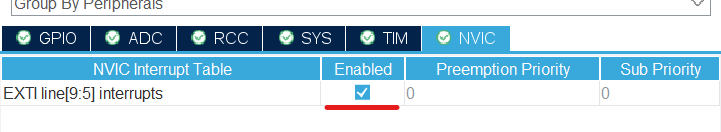

---

## How the code works

### Sampling ([`app.c`](Core/Src/app.c))

Each TIM3 update starts one conversion. In `HAL_ADC_ConvCpltCallback`:

1. Read the sample.
2. If the sample was the voltage, pass it to `ACM_ProcessVoltageSample()`. If it was the current, pass it to `ACM_ProcessCurrentSample()`.
3. Point the ADC at the other channel and re-arm it.

### True RMS with a sliding window ([`acmeter.c`](Core/Src/acmeter.c))

Each channel has a 1100-sample ring buffer, plus running totals of Σx and Σx². A new sample replaces the oldest one:

```c
sum            += new - old;
sum_of_squares += new*new - old*old;
rms = sqrt(sum_of_squares/N - (sum/N)^2) * (3.3/4095) * scale;
```

Each update costs the same no matter how big the buffer is. Subtracting mean² removes the 1.65 V offset added by the front-end. The scale factors (30.5848 for voltage and 1.2876 for current) were calibrated on the real board.

The code favors integers where possible. The Cortex-M3 has no FPU, so float operations are emulated in software. Integer math is faster, uses less memory, and draws less power.

### Frequency and phase: adaptive hysteresis

Crossing exactly 1.65 V is unreliable. Noise around the midpoint can cross it several times in one period, and with a finite sample rate the signal is rarely sampled exactly at 1.65 V. Two earlier approaches had problems:

- A fixed band around 1.63 V was hard to size for every amplitude and frequency.
- Adding a minimum spacing between crossings worked at 50 Hz but did not hold up at other frequencies.

The final method uses a threshold proportional to the signal's own RMS:

```
d = 0.65 × RMS   (in ADC counts)

state "range 2"  →  sample > mean + d   →  call update_freq_buffer()   → state "range 1"
state "range 1"  →  sample < mean − d   →                               → state "range 2"
```

The signal must swing all the way from below −d to above +d, so only one event can happen per period.

- **Frequency.** On each voltage event, the code stores the number of samples since the previous event in a 70-entry ring buffer and averages it, then computes `freq = 10000 / (3 × samples_per_period)`. This works from **25 Hz to 999 Hz with less than 1 % error**.
- **Phase.** On each current event, the code stores the number of samples since the last voltage event, averages it over 70 periods, and converts it with `phase = 2π × delay / samples_per_period`.
- **Power.** PF = |cos φ|, S = V·I, P = V·I·|cos φ|, Q = V·I·|sin φ|.

### Display ([`display.c`](Core/Src/display.c))

- `DisplayNumber(n)` clamps the value to 0 – 999 and splits it into three digits.
- `SetBCD(v)` writes the 4-bit code to BCD_A – D.
- On each TIM2 tick (180 Hz), `Display_Refresh()` turns all digits off, sets the BCD code, and turns on the next digit. A full refresh takes 3/180 s ≈ 16.7 ms, which matches the eye's ~1/60 s persistence of vision.

Values are scaled to use all three digits: V × 10, and I, PF, P, Q, S × 100.

To keep the display steady, the value updates only every 60 TIM2 ticks (about 0.33 s), controlled by `count1`.

### Button and debouncing

A press fires the EXTI interrupt, which only sets `flag2` and restarts `counter20`. TIM2 then counts 6 ticks (about 33 ms) and sets `flag20`. When both flags are set, the main loop checks that the button is **still** pressed, and only then moves to the next mode. This filters out contact bounce without `HAL_Delay()`, so the CPU keeps sampling.

After a mode change, the mode number (1 – 7) appears for 200 ticks (about 1.1 s), and then the live value replaces it.

---

## Notes for rebuilding

- **Code sources.** Everything here was recovered from the code listings in the report and organized into modules. The behavior and variable names are unchanged. Two parts were filled in where the report describes the behavior but does not print the code:
  - the "show the mode number for ~1 s" branch in `App_Loop()`
  - the BCD port array in `display.c`
- **PWM compare value.** The report sets the TIM4 compare value to `1000` while ARR is `999`. In PWM mode 1, a compare value above ARR holds the output high all the time. If the −12 V rail does not come up, try `duty = 500` for a 50 % square wave.
- **Frequency constant.** The `10000 / 3` in `update_freq_buffer()` is the TIM3 trigger rate in Hz. If you change TIM3 or the channel scheme, recalibrate this constant against a known frequency.
